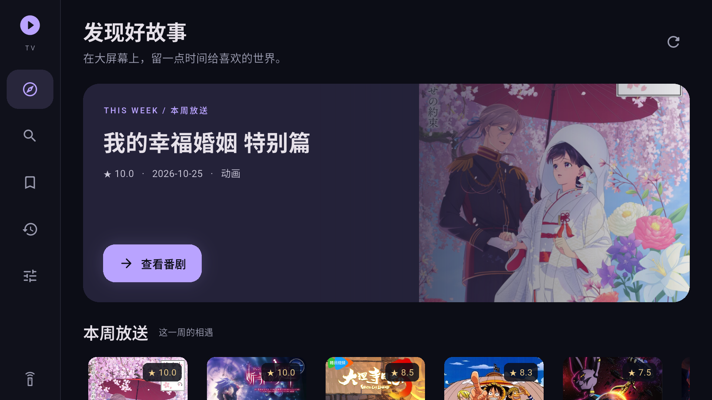
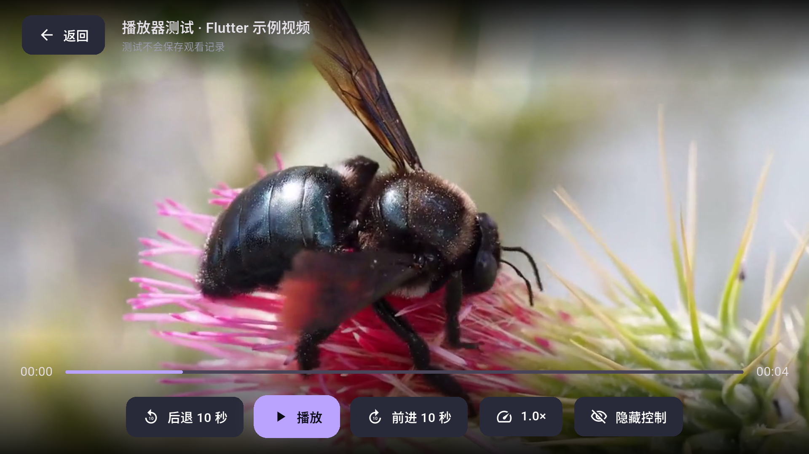

# 验证记录

本文件区分源码实现、自动化测试、真实目录接口、Android 构建、模拟器和电视实机结果。

## GitHub Actions Release 配置（2026-10-17，Asia/Shanghai）

- 新增 `v*` 标签触发的 Android Release 工作流，固定 Flutter 3.47.5 / JDK 17，校验标签与应用版本、签名 Secrets，检查后构建三种 ABI 的 APK，验签、计算 SHA256、保存构建附件并通过 GitHub CLI 发布。`-rc.1` 等标签标为 Pre-release。
- Gradle Release 使用环境变量或本机被忽略的 `android/key.properties`，不再使用 Debug 密钥；无签名配置时，实际执行 `:app:preReleaseBuild` 按预期失败。Debug 不需要正式签名。日志：`artifacts/release-missing-signing.log`。
- `actionlint 1.7.12` 检查通过；实际执行工作流内的版本校验代码，`v0.1.0` 通过、`v9.9.9` 被拒绝。`tools/check.ps1` 通过锁文件校验、静态检查、51 项测试和本地 MacCMS 协议探针；日志：`artifacts/actions-check.log`。
- 本机使用独立生成、有效期 1 天的临时验证密钥，通过同名环境变量构建 Release APK：armeabi-v7a 33827910 字节、arm64-v8a 36779256 字节、x86_64 41737155 字节。三个 APK 均通过 `apksigner verify`，证书 SHA256 都与临时密钥导出证书相同。密钥已删除；这些 APK 仅用于本地构建验证，不是用户正式签名的发布包。日志：`artifacts/release-smoke-build.log` / `release-smoke-verification.log`。
- 构建发现 Flutter 3.47.5 的 `--no-pub` 会跳过平台插件注册文件重建，导致 Release 引用开发依赖 `integration_test` 而编译失败。最终工作流使用默认 Pub / 平台生成步骤，成功排除开发插件，且构建前后 `pubspec.lock` 无变化。没有编辑生成文件或将测试插件移入正式依赖。
- 尚未配置用户的 GitHub Secrets，未提交 / 推送代码或标签，未在线执行 Actions、创建 GitHub Release，未使用用户正式密钥。本机验证使用 Windows / JDK 25，不能代替 Ubuntu / JDK 17 上的首次 Actions 运行结果。本轮未操作模拟器或电视。

## 修正为 Animeko 同源订阅（2026-10-17，Asia/Shanghai）

- 原 MacCMS 首版偏离“沿用 Animeko 数据源”的要求。本次默认改为 Animeko README 指向的 creamycake ani-subs 在线订阅，直接保留并使用上游规则，不把站点替换为 MacCMS。MacCMS 旧配置保留为可选扩展；Talker 保留。
- 核对上游 Animeko commit `f136e547829fc142232b8311d6ad57e2be890c7a` 的订阅读取、SelectorSearchConfig、CSS / JSONPath 条目、线路和 WebVideoMatcher 契约。参考文件保存在 `artifacts/upstream-animeko/`，产品通过远程订阅获取规则，不打包上游 Kotlin 引擎。
- 在线订阅实际返回 20 个源（19 web-selector、1 json-api）。源管理首次 / 旧安装升级自动补入默认订阅，支持刷新和添加兼容订阅；启停状态、已有自定义源及本机历史保留。
- 最终 `flutter analyze` 无问题，51 项单元 / Widget 测试通过，完整日志为 `artifacts/animeko-check.log`（早先 50 项测试日志为 `artifacts/animeko-tests.log`）。新增覆盖新旧订阅格式、自动导入、稳定 ID 合并与停用保留、坏订阅不覆盖旧配置、CSS / indexed / JSONPath 搜索、线路正则过滤时的位置对应、JSON API 请求模板转义与精确候选线路、嵌套解析页排除、旧播放专用 UA 与新全程 UA 优先级、SQLite v1→v2 迁移和源绑定 / 请求头跨文件数据库重开恢复。
- 新主应用 Debug APK 构建通过，输出 `artifacts/mamba-tv-debug.apk`，大小 267286783 字节，SHA256 为 `372285BC237A1A6C143057F7B53B99C5B4E2F3B81746C3009DC1CEABDD10519A`；未安装到模拟器。
- `dart tools/probe_animeko_sources.dart` 使用实际订阅、实际站点规则和网络请求：稀饭动漫 Next 搜索区分《葬送的芙莉莲》与第二季，读取 2 条线路、共 56 个线路集数条目，选定源集数取址成功；视频地址 Range 请求返回 HTTP 206、`video/mp4`，文件头包含 MP4 `ftyp` 标记。探针仅读取首个数据块，不下载整集，也不打印签名地址或认证 Headers。结果见 `artifacts/animeko-live-source.log`。
- 使用现成 html 0.15.7、json_path 0.9.0、flutter_inappwebview 6.2.0-beta.3、dio_cookie_manager 3.5.0 / cookie_jar 4.0.9。网页解析路径使用 Android WebView；请求头和源集数绑定按 schemaVersion 2 保存，后续打开同一绑定重新取址以应对签名过期。
- WebView 6.1.5 的 Android 1.1.3 插件在当前 AGP 9.1 下因旧 `proguard-android.txt` 配置构建失败。改为明确锁定上游已修复的 6.2.0-beta.3 / Android 1.2.0-beta.3，不修改 Pub 全局缓存、不降低现有 Android 构建工具；这是预发布依赖，需要后续目标设备验收。修复依据 [上游 issue #2765](https://github.com/pichillilorenzo/flutter_inappwebview/issues/2765)。
- 按用户要求，本轮没有启动、安装或操作模拟器。视频地址可读不是电视解码验收；19 个网页站点的原生 WebView 取址与实播未逐个验收。BT / RSS 下载引擎未接入，界面和文档不把它们标为可播放源。

## MacCMS 数据源与 Talker首版历史（已由上方同源订阅修正）

- 实现自定义 HTTPS MacCMS v10 JSON 接口的新增、编辑、删除、启停和连接测试；章节入口可搜索 / 分页、选择作品和播放线路，并在核对集数后只绑定当前 Bangumi 章节。未预置第三方站点，未按名称自动关联整季。
- Talker / Dio / Riverpod 集成版本均锁定 5.1.20；复用同一实例和 TalkerScreen，增加框架 / 异步 / 目录 / 播放 / 数据源异常记录。保留最近 300 条内存日志，视频源日志不含 endpoint query、响应正文和播放地址，Riverpod 只输出状态类型且排除高频播放状态。
- `flutter analyze --no-pub` 无问题，42 项单元 / Widget 测试全部通过。日志为 `artifacts/sources-talker-check.log`。
- 主应用 Debug APK 构建成功，输出 `artifacts/mamba-tv-debug.apk`，SHA256 为 `DD0E1230A20604F0FFD8CFBD98FDF80409509D55C5CD446BA8C2C2589186C300`；构建包含新加入的 Talker / 分享等原生依赖。本轮未安装 APK。
- 新增测试覆盖 MacCMS 查询参数、字符串数字字段、JSON 字符串响应、资源 ID 核对、多线路分隔符及逗号兼容、HTTPS 直链识别、失效 / 非 JSON 接口、日志上限与地址脱敏；数据源配置使用 SharedPreferences 官方内存后端验证序列化、重建仓库恢复、并发写入与删除，未声称电视设备持久化验收。
- 选择器测试覆盖启用源过滤、旧响应丢弃、释放后完成请求、明确选集后只绑定目标章节，以及把该地址交给现有 PreparePlayback / FakeEngine。Widget 测试覆盖 960×540 和 640×360 的数据源编辑、连接状态、启停、确认绑定 → 播放器路由，以及打开 Talker 日志页；播放器使用测试引擎，这不等同于真实视频解码验收。
- `dart run tools/probe_maccms.dart` 使用本机 HttpServer 和官方字段契约的固定样例验证真实 HTTP 传输：第一页 / 第二页各 1 条、2 个线路、2 个可识别的 HTTPS 视频地址。输出模式明确为 `local-contract-fixture`，不是线上资源站或真实视频播放结果。
- 真实 Bangumi 探针再次通过：首页 108 条、搜索 5 条、条目 400602 的 36 个章节；组合筛选“中国 + 奇幻 + 2024 / heat”返回 73 条，前两页各 20 条并检查标签、年份及无重复。
- 按用户要求，本轮未操作、启动、安装或测试模拟器。尚未提供真实 MacCMS 接口地址，因此未完成真实视频源搜索、播放或电视遥控器验收。可以在应用设置中添加接口，也可使用 `dart run tools/probe_maccms.dart <HTTPS接口> <关键词>` 单独检查配置站点；探针不会打印接口参数或播放地址。

## Windows 鼠标与键盘修复（2026-10-17，Asia/Shanghai）

- 用户反馈属实：通过 Windows Computer Use 直接在模拟器窗口按右方向键、点击番剧卡片，以及点击扩展遥控器右键，原配置均无响应。之前 ADB 注入按键通过，不能代表宿主机鼠标键盘正常。
- 「Send keyboard shortcuts to」已为 Virtual device；临时启用 Enforce keycode forwarding 未改善，已还原该开关。
- 原 AVD 为 `hw.keyboard=no` / `hw.screen=no-touch`；Android 的输入设备列表只有 AT 键盘与电源按钮。直接操作窗口时，getevent 未观测到相应事件。该实例使用 Android Emulator 37.2.12、API 36 Android TV。
- 在独立测试 AVD 设置 `hw.keyboard=yes` 后出现 `qwerty2` 虚拟键盘，Windows 方向键恢复。强制 VirtioMouse 会捕获鼠标；VirtioTablet 配置未能让窗口点击进入应用。最终启用 `hw.screen=multi-touch` 并通过 `-feature -VirtioMouse -feature -VirtioTablet` 使用鼠标转触控路径，出现 virtio_input_multi_touch 设备，Windows 鼠标点击成功进入详情。
- 相同修复已应用到用户的 `Mamba_TV_API36:5554`，原配置备份到 artifacts。冷启动后，Windows 电脑 ↓ 将焦点移到第一张卡片，→ 移到第二张，Windows 鼠标点击第三张进入《大理寺日志 第三季》详情。上述验收操作使用 Windows 输入，未调用 ADB input。
- 新增 `tools/start-tv.ps1`，负责 AVD 校验、配置备份、可选重启、输入模式、等待完整启动和可选打开应用。已用 `-Restart -LaunchApp` 在主 AVD 上完整执行成功；没有修改应用业务源码或清除用户数据。
- 这是开发模拟器的鼠标便利配置，仍是 Android TV 系统映像；新增触控能力不构成真实非触屏电视验收。

## 运行复检（2026-10-17，Asia/Shanghai）

- 重新执行静态检查和 24 项单元 / Widget 测试，全部通过；本次未修改业务源码。
- 重跑真实 Bangumi 探针：首页 107 个条目、搜索 5 个结果、条目 400602 的 36 个章节（包含特别章节）、高分查询 20 个条目均成功。
- 原设备 `emulator-5554` 持续被 ADB 标记为 `offline`，单次重连未恢复。没有停止或重置该实例；本次在独立的新 AVD `Mamba_TV_Verify_API36`（Android TV API 36 x86_64，1920×1080）上验证。测试 AVD 文件保存在 `artifacts/runtime-verify.avd`，可供后续复检使用。
- 新 AVD 首次启动时安装曾提示 `device is still booting`；确认 `sys.boot_completed=1` 后重试原生集成测试通过。视频实际画面、时间推进、媒体键暂停、Select 恢复控制面板、引擎释放和示例不写入历史均通过。中央非黑像素比例 `0.9822916666666667`，日志为 `artifacts/runtime-recheck-native.log`。
- 主应用真实目录显示正常；ADB ↓、→ 移动焦点，确认键进入《决斗大师 LOST ～断罪的少年～》详情。加入追番后本地资料库立即出现条目，停止并重新启动应用后收藏仍然保留。
- 从真实详情进入未配置地址的章节，正确显示「为这一集选择视频」，返回详情和资料库正常。没有用示例视频替代该番剧。
- 此轮操作日志未发现崩溃、ANR、未处理 Dart 异常或 Riverpod 生命周期错误。截图为 `artifacts/screenshots/runtime-focus.png`、`runtime-detail.png`、`runtime-favorite.png`、`runtime-source.png`、`runtime-library.png` 和 `runtime-persistence.png`。
- 主应用 APK 重新构建通过，SHA256 与交付包一致：`2BDE13C3AF47224311D0C7A621C94A01AEE6AFB6CD7E450F9A9FFFBCAE766479`。构建日志为 `artifacts/runtime-recheck-build.log`。
- 以上是独立模拟器结果；原 offline 模拟器、电视实机和真实番剧资源播放未通过本轮设备验收。

## Riverpod 迁移验证（2026-10-17，Asia/Shanghai）

- 统一使用 `flutter_riverpod 3.4.3`。已移除直接依赖 `provider`、全部 ChangeNotifier ViewModel 及旧通知基类；业务源码未使用 Riverpod legacy API。Domain / Data 不依赖 Riverpod。
- 首页、搜索、详情、追番、历史、设置和播放均通过 Riverpod 发布状态和执行命令；领域仓库与引擎工厂通过根 ProviderScope 注入。
- `flutter analyze --no-pub` 无问题；`flutter test test --no-pub` 24 项全部通过。
- 迁移测试覆盖：首页与搜索状态隔离、过期响应与释放后返回、收藏命令与资料库流同步、旧状态快照不可变、设置重新进入时恢复持久化值、最后一个播放器监听者移除后保存和释放、同集不同路由引擎隔离，以及原有遥控与页面回归。
- 最终源码在 Android TV API 36 x86_64 模拟器上通过原生集成测试：真实视频时间推进、首帧、尺寸、媒体键暂停、Select 恢复控制面板、引擎释放与测试不写入历史。
- 实际视频截图人工确认有蜜蜂画面；中央区域非黑像素比例为 `0.9829861111111111`。数值和截图保存在 `artifacts/screenshots/native-player.json` / `native-player.png`，原生测试日志为 `artifacts/riverpod-native-test.log`。
- `tools/check.ps1 -BuildApk` 完整通过依赖锁文件校验、静态检查、24 项测试和主应用 Debug APK 构建。新版 `artifacts/mamba-tv-debug.apk` 的 SHA256 为 `2BDE13C3AF47224311D0C7A621C94A01AEE6AFB6CD7E450F9A9FFFBCAE766479`，大小为 262944440 字节。检查日志为 `artifacts/riverpod-check.log`。
- 新主应用 APK 安装与启动成功，真实 Bangumi 首页和海报显示正常。通过 ADB 发送 ↓、→ 后页面滚动，紫色焦点移动到第二张番剧卡片。对比截图为 `artifacts/screenshots/riverpod-home.png` / `riverpod-after-direction.png`。
- 本次未重复请求真实 Bangumi 探针；下方真实 API 结果保留为首版验证记录。真实电视硬件验收仍未完成。

## 首版验证记录（迁移前）

- Flutter 3.47.5，Dart 3.13.4；依赖由 pub 解析，已保存 pubspec.lock。
- Bangumi 真实请求：calendar 返回 107 个去重条目；搜索「葬送的芙莉莲」返回 5 个结果，选择条目 400602 的详情成功，读取 36 个章节（包含特别章节）；空关键词高分查询返回 20 个条目。
- 最终 `flutter analyze` 无问题，`flutter test test` 19 项全部通过，涵盖续播规则、视频地址校验、数据库增删改与关闭重开后的持久化、播放保存与资源释放、过期搜索结果、D-pad / Select / Enter、首页详情收藏返回、搜索和三种窗口尺寸。
- `tools/check.ps1 -BuildApk -ProbeLive` 完整通过；聚焦滚动修复后再次通过静态检查、19 项测试和 APK 构建，输出主应用 `artifacts/mamba-tv-debug.apk`。SHA256：`A3DC02B2E9647CD45237053CD606B46BF335BDB34EFF0763C35783D29D88B838`。这是 Debug 签名的开发包。

## Android TV 验证（2026-10-17，Asia/Shanghai）

- Android TV API 36 x86_64 模拟器 `Mamba_TV_API36`，1920×1080，系统具有 `android.hardware.type.television` / Leanback 特性。
- Debug APK 构建成功，安装与主 Activity 启动成功。目录首页真实海报、中文文本和布局已截图检查。
- 原生集成测试使用真实 media_kit / MediaCodec，验证示例视频时间推进、首帧通知、视频尺寸、媒体播放键暂停、Select 恢复隐藏的控制面板、销毁播放器，以及测试不写入番剧历史。
- 主机侧截图测试排除页头和控制栏后，中央视频区域非黑像素超过 0.1 的样片验收阈值；截图人工确认显示蜜蜂示例视频。逐次测量值保存在 `artifacts/screenshots/native-player.json`。
- 实际遥控器确认键已从真实目录首页进入详情，读取并显示章节；页面测试补充检查首次聚焦时标题仍然可见。
- 样片不是番剧资源。以上验证不能证明真实电视硬解、第三方番剧源、ASS、HDR 或 DRM 兼容。

截图：

## 构建环境修复

- Kotlin 插件首次下载中断：从 Maven Central 获取对应文件，按官方模块元数据的 SHA256 校验后填充本机 Gradle 缓存；未更换依赖来源或禁用校验。
- Windows 项目位于 D 盘、Pub 缓存位于 C 盘，Kotlin 增量缓存出现 `this and base files have different roots`。项目内设置 `kotlin.incremental=false`，避免跨盘相对路径缓存错误；代价是 Kotlin 插件源码变更时编译更慢。配置依据 [Kotlin 官方文档](https://kotlinlang.org/docs/gradle-compilation-and-caches.html)。
- media_kit 默认输出在 API 36 模拟器中出现 EGL_BAD_ATTRIBUTE，时间推进但视频黑屏。已按照 [上游复现与兼容方案](https://github.com/media-kit/media-kit/issues/1343) 为检测到的模拟器采用 MediaCodec Surface 输出；物理设备保留默认配置。测试加入视频中央像素检查，避免仅凭进度、尺寸或首帧通知误判播放成功。

## 尚未确认

- 真电视 / 盒子的遥控器差异、硬件解码、4K / HDR、复杂 ASS、多音轨样片。
- 真实番剧资源源的完整播放链路；当前没有自动视频源适配器。
- 生产签名、商店发布与账号 / 同步 / 下载 / BT。
